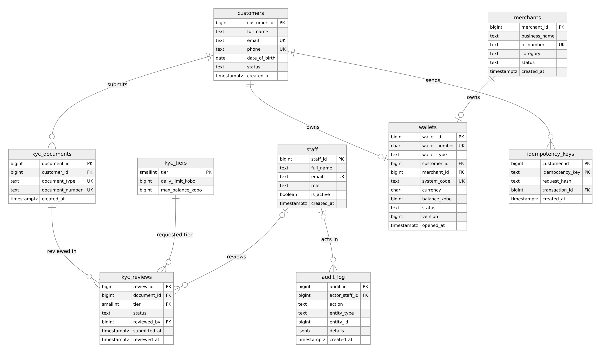
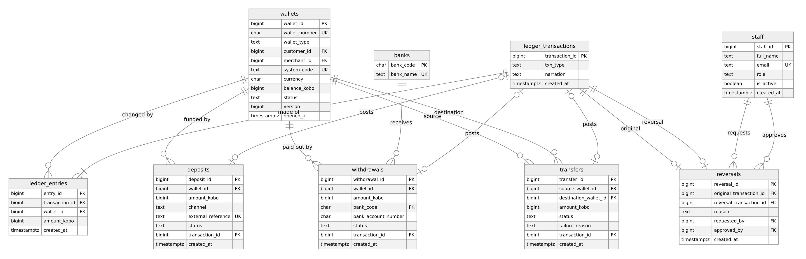

# Portfolio 1: Database Design and Modelling

The relational design for [Kolaro Wallet](../README.md#selected-case-study-kolaro-wallet), built and tested on PostgreSQL 16.

| Evidence | File |
|---|---|
| Schema | [sql/01_schema.sql](sql/01_schema.sql) |
| Triggers for multi-row rules | [sql/02_rules.sql](sql/02_rules.sql) |
| Audit views | [sql/03_views.sql](sql/03_views.sql) |
| Sample data | [sql/04_sample_data.sql](sql/04_sample_data.sql) |
| Normalisation, 1NF to BCNF | [normalisation.md](normalisation.md) |
| Constraint test results | [evidence/constraint-test-results.txt](evidence/constraint-test-results.txt) |
| Balance and ledger checks | [evidence/sample-data-checks.txt](evidence/sample-data-checks.txt) |
| Tables and constraints, read back from PostgreSQL | [evidence/schema-catalog.txt](evidence/schema-catalog.txt) |

## How to run it

From the repository root, with the lab running:

```bash
./portfolio-1-database-design/run.sh
```

This rebuilds the `wallet` schema from nothing, loads the sample data, runs the tests and rewrites the evidence files. It deletes anything already in that schema, including the large data set from Portfolio 2.

## ER diagrams

The schema has 16 tables, so it is shown in two focused views. The [full diagram](er-diagram.png) has every table on one page. All diagrams are drawn from Mermaid source files (`.mmd`) in this folder.

**Customers, KYC and ownership**



**Ledger and money operations**



## Design decisions

| Decision | Reason |
|---|---|
| Money is stored as whole kobo in `BIGINT` | Floating-point types can't represent amounts like 0.10 exactly. Integers avoid rounding errors and are simple to sum. |
| Double-entry ledger | Each movement has entries that net to zero, so money can't appear or vanish without showing up in the trial balance. |
| Append-only ledger | Financial history is never edited. A mistake is corrected with a new reversal transaction, which leaves the original visible. |
| Requests are separate from the ledger | A transfer can be pending or failed with no money moved. The ledger only records what actually happened. |
| System wallets | A deposit needs a second side. The settlement wallet stands for money outside Kolaro, so it is allowed to go negative. |
| `BIGINT` identity primary keys, with a separate `wallet_number` | Small keys keep indexes compact. Customers see the wallet number, so internal IDs stay private. |
| `TEXT` with `CHECK` instead of `ENUM` types | A permitted value can be changed with an ordinary constraint change. |
| Few secondary indexes for now | Indexes are added in Portfolio 2, where their effect is measured. |

## Keys and constraints

| Mechanism | Used for | Example |
|---|---|---|
| Primary key | Identifying each row | `wallets.wallet_id` |
| Composite primary key | A natural two-part identity | `idempotency_keys (customer_id, idempotency_key)` |
| Foreign key | Valid references, and blocking deletes of referenced rows | `ledger_entries.wallet_id` |
| `UNIQUE` | One-of-a-kind values | `deposits.external_reference` |
| Unique index on an expression | Case-insensitive email | `customers_email_unique` on `lower(email)` |
| Partial unique index | A rule that applies to some rows | One pending or approved review per document and tier |
| `CHECK` | Valid values within a row | `wallet_has_exactly_one_owner` |
| Deferred constraint trigger | Rules across rows, checked at commit | `ledger_entries_balanced` |
| `BEFORE` trigger | Blocking changes | `ledger_entries_append_only` |
| `AFTER` trigger | Automatic audit record | `wallets_audit_status` |

## How it was tested

**Constraint tests:** 31 tests attempt invalid and valid operations, and compare the result with the expected SQLSTATE. All 31 pass. Each attempt is undone afterwards, and `run.sh` exits with an error unless tests ran with no failures. An early version reported success with 0 tests because a `ROLLBACK` also erased the results table, which is why that check exists.

**Sample data checks:** after a deposit, transfer, merchant payment, withdrawal, failed transfer, reversal and wallet freeze:

- Every wallet's stored balance matches its ledger entries.
- The trial balance is 0 across 12 entries.
- The failed transfer has no ledger transaction.
- The freeze wrote an audit row naming the compliance officer.

## Known limitations

These rules aren't enforced by this schema. Portfolio 3 adds triggers and a transfer procedure that enforce the first three ([details](../portfolio-3-transactions-concurrency/README.md#rules-added-to-the-schema)).

| Rule | Current status |
|---|---|
| A frozen wallet can't send money | The schema stores the status but doesn't block ledger entries. |
| `balance_kobo` always equals the ledger | Detected by `v_wallet_balance_audit`, not prevented. |
| A request's amount matches its ledger entries | Not checked. |
| KYC daily and balance limits | Stored in `kyc_tiers`, but not applied. |
| `audit_log.entity_id` refers to a real row | It can refer to several tables, so it has no foreign key. |
| Append-only triggers can't be bypassed | A superuser can disable triggers. A production system would use a less privileged application role. |

Only NGN is supported, which is why cross-currency rules aren't modelled.

## Tools

- PostgreSQL 16: https://www.postgresql.org/docs/16/
- Mermaid and `minlag/mermaid-cli` for rendering diagrams: https://mermaid.js.org/
