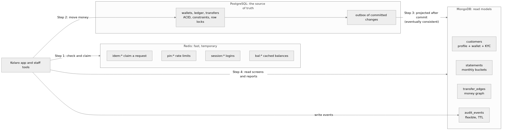

# Portfolio 4: NoSQL and Advanced Data Models

Kolaro Wallet's data modelled in a **document store (MongoDB 7.0)** and a **key-value store (Redis 7.4)**, with a **graph traversal** in MongoDB and a **column-family design**. Everything is loaded from the same PostgreSQL data used in Portfolios 1–3, so the two models can be compared directly.

The conclusion is that no single model fits everything. **The ledger stays in PostgreSQL.** MongoDB serves read-heavy screens and flexible records, and Redis handles short-lived, high-rate state.



## How to run it

From the repository root, with the lab running:

```bash
./portfolio-4-nosql/run.sh
```

It takes about 3 minutes. It rebuilds PostgreSQL (Portfolio 1 schema, Portfolio 2 data, Portfolio 3 procedure), loads MongoDB from it, then runs every demonstration and rewrites [evidence/](evidence/). It replaces the MongoDB `kolaro` database and all Redis keys.

## 1. Document model (MongoDB)

### From tables to documents

The question for each collection was: **what does the application read together?** That data goes in one document.

| Collection | Documents | Replaces in PostgreSQL | Design choice |
|---|---:|---|---|
| `customers` | 100,003 | `customers`, `wallets`, `kyc_documents`, `kyc_reviews` | **Embedding.** Support always needs the profile, wallet and KYC history together. One read instead of a four-table join. |
| `statements` | 267,761 | `ledger_entries` + `ledger_transactions` + `wallets` + `merchants` | **Bucket pattern.** One document per wallet, month and block of up to 500 entries. Each entry carries the balance after it and a copy of the counterparty's name and category. The statement screen reads one document. |
| `transfer_edges` | 127,410 | `transfers` (October 2026) | **Graph edges.** One document per transfer, `{from, to, amount, at}`, traversed with `$graphLookup`. |
| `audit_events` | 50,000 | `audit_log` (JSONB `details`) | **Polymorphic documents.** Five event types with different fields in one collection. Kept for 180 days by a TTL index. |
| `daily_spend` | 1 per wallet per day | (none) | A counter document for atomic limit checks. |

The export queries are in [export/](export/). For example, [export/customers.sql](export/customers.sql) builds each customer document with `json_build_object` and `json_agg`. Dates are written as MongoDB Extended JSON, so they import as real dates. The data is streamed straight from `psql` into `mongoimport`.

**Every row arrived.** The load compares counts in both databases ([evidence/load.txt](evidence/load.txt)):

| Data | PostgreSQL | MongoDB |
|---|---:|---:|
| Customers | 100,003 | 100,003 |
| Statement entries, August–October 2026 | 882,099 | 882,099 |
| Completed transfers, October 2026 | 127,410 | 127,410 |

**Size.** The 267,761 statement buckets hold 229 MB of BSON but take 54 MB on disk, because WiredTiger compresses them. The largest bucket is 103 kB, far below MongoDB's 16 MB document limit. The 500-entry cap keeps it that way even for the busiest wallet.

### Schema validation

MongoDB is flexible, not schema-less. Each collection has a `$jsonSchema` validator ([mongo/01_collections.js](mongo/01_collections.js)), and every imported document passed it. [evidence/writes.txt](evidence/writes.txt) shows the validator rejecting six bad documents (code 121) with the rule that failed:
- A missing email.
- An upper-case email.
- A non-Nigerian phone number.
- A balance stored as a string.
- A statement bucket with 501 entries.
- An unknown event type.

It also shows an audit event with extra, unplanned fields being accepted, because only the common fields are required.

### Queries, before and after indexing

Six queries for real operations ([mongo/04_queries.js](mongo/04_queries.js)), measured as the median of 5 runs after a warm-up. Indexes are in [mongo/03_indexes.js](mongo/03_indexes.js).

| Query | Operation | No index (ms) | Indexed (ms) | Plan after indexing |
|---|---|---:|---:|---|
| M1 | Customer profile, wallet and KYC by email | 10.7 | **0.65** | `IXSCAN` on `email`, 1 document read |
| M2 | Latest 50 statement entries, busiest wallet | 55.9 | **0.81** | `IXSCAN`, 1 bucket read, `$slice: -50` |
| M3 | Tier-1 customers over the N300,000 balance cap | 77.4 | 7.2 | `IXSCAN` on `(kyc.current_tier, wallet.balance_kobo)` |
| M4 | October spending by merchant category (aggregation) | 229.8 | 225.3 | `IXSCAN` on `month`, but no faster |
| M5 | Money trail, 2nd and 3rd hops (`$graphLookup`) | 13,050 (single run) | **18.2** | `IXSCAN` on `from` for every step |
| M6 | One customer's failed logins in the last 7 days | 9.7 | **0.79** | `IXSCAN`, 2 keys, 2 documents |

Full plans and results: [baseline](evidence/queries-baseline.txt), [indexed](evidence/queries-indexed.txt).

- **M2 against PostgreSQL.** Portfolio 2's best statement query (Q1b) took 0.42 ms with a 233 MB covering index. M2 takes 0.81 ms by reading one pre-built bucket, with a 5 MB index. Both are fast. The document model gets there by doing the work at write time, building the bucket, instead of at read time.
- **M3 found a real problem.** 26,474 tier-1 customers hold more than the tier-1 cap. Portfolio 1 lists KYC limits as "stored but not enforced", and the generated data never respected them. With the profile and KYC tier in one document, the check is one indexed query.
- **M4 didn't improve.** The index finds October's 87,558 buckets quickly, but `$unwind` and `$group` over the 246,631 entries inside them cost far more. As with Portfolio 2's Q5, an index can't make "read a whole month" cheap. A pre-computed monthly summary could.
- **M5 shows why graph traversals need an index.** Without one, every `$graphLookup` step scanned all 127,410 edges, taking 13 seconds. With an index on `from`, it took 18 ms, 716 times faster. Portfolio 2's recursive SQL query (Q7) had the same problem and the same fix. *Note:* `explain()` reports only the outer `$match`. The `$graphLookup` steps' own index use doesn't appear in its statistics, but the time shows it.

### Atomic updates on one document

MongoDB guarantees that one update to one document is atomic. The [spending-limit test](evidence/daily-spend-concurrency.txt) used 10 processes sending 50 payment requests of N2,000 at once, against a daily limit of N50,000. At most 25 should be approved.

| Approach | Approved | Over the limit | Stored "spent" vs reality |
|---|---:|---:|---|
| **Naive:** read the counter, decide in the app, `$set` the new total | 50 | **N50,000** | Understated by N66,000 (lost updates) |
| **Atomic:** one `updateOne` whose filter checks `spent + amount <= limit` and whose update uses `$inc` | **25** | 0 | Exact |

This is the same lost-update problem as Portfolio 3, Part A, with the same cure: make the check and the change one atomic operation.

[evidence/writes.txt](evidence/writes.txt) also shows a KYC upload and its approval. Each is one atomic update to an embedded array, using `$push` and `arrayFilters`. In PostgreSQL it was two inserts into two tables.

## 2. Key-value model (Redis)

[redis/demo.sh](redis/demo.sh), with output in [evidence/redis.txt](evidence/redis.txt):

| Pattern | Keys | Result |
|---|---|---|
| **R1 Idempotency** | `idem:<customer>:<key>` | 20 copies of one request ran `SET ... NX EX 86400` at once: **exactly 1 got OK**, and 19 got nil. The key expires after 24 hours. PostgreSQL's `idempotency_keys` table stays the durable record. |
| **R2 Rate limiting** | `pin:fixed:*` and `pin:sliding:*` | A fixed window (`INCR` + `EXPIRE`) blocked attempts 6 and 7, but resets on the minute boundary. A sliding window ([sliding_window.lua](redis/sliding_window.lua), a sorted set updated in one atomic Lua script) allowed exactly 5 attempts in any 60 seconds. |
| **R3 Sessions** | `session:<token>` (hash) | Login details with a 15-minute expiry. |
| **R4 Cache-aside** | `bal:<wallet>` | The cached balance went stale after a real transfer through Portfolio 3's `transfer()`, until the key was deleted. Lesson: a cached balance may be *shown*, but the spending check always reads PostgreSQL. |
| **R5 Activity feed** | `feed:<wallet>` (list) | `LPUSH` + `LTRIM` keeps only the newest 5 items. |

Each key used 96–160 bytes. `redis-benchmark` measured roughly 220,000 to 300,000 operations a second at a median of about 0.1 ms on the lab VM.

## 3. Column-family design (not implemented)

A wide-column store such as Apache Cassandra suits **statements at very large scale**: many writes, always read by one known key. This is a design only, for comparison. It wasn't run in the lab.

```sql
-- CQL. One partition per wallet per month, entries stored newest first.
CREATE TABLE statement_entries (
    wallet_number   text,
    month           text,         -- '2026-10'
    created_at      timestamp,
    entry_id        bigint,
    amount_kobo     bigint,
    balance_after   bigint,
    txn_type        text,
    counterparty    text,
    PRIMARY KEY ((wallet_number, month), created_at, entry_id)
) WITH CLUSTERING ORDER BY (created_at DESC, entry_id DESC);
```

- **Partition key `(wallet_number, month)`** puts one wallet's month on one node and bounds the partition's size, like the MongoDB bucket.
- **Clustering columns** keep entries sorted on disk, so "newest 50" is one sequential read.
- **What it gives up:** no joins, no ad-hoc queries on other columns, no multi-row transactions. Consistency is tunable per query (`QUORUM`, `ONE`). A table is designed for one query, so each new screen needs its own copy of the data.

## 4. Suitability: which model for which data

| Need | Best fit | Why |
|---|---|---|
| Moving money: ledger, balances, transfers | **PostgreSQL** | Multi-row ACID transactions, foreign keys, CHECKs, deferred constraints and row locks (Portfolio 3). MongoDB has multi-document transactions, but only on a replica set, and its strengths lie elsewhere. |
| Customer profile and KYC history | **MongoDB** | Always read together, nested and growing. One document replaces a four-table join, and it can gain new KYC fields without a migration. |
| Statement screen | **MongoDB** (or Cassandra at large scale) | A read model built after commit. One bucket read per screen. |
| Audit and security events | **MongoDB** | Different shapes per event type, append-heavy, automatic expiry with a TTL index. |
| Money-trail investigations | MongoDB `$graphLookup` for 2–3 hops; a **graph database** such as Neo4j for deep or many-path analysis | `$graphLookup` handled 3 hops in 18 ms, but it can't filter paths by order of time or weight paths. A graph database can. |
| Idempotency, rate limits, sessions, caches | **Redis** | In memory, sub-millisecond, atomic single commands and Lua scripts, automatic expiry. Data loss on restart is acceptable or recoverable, because PostgreSQL holds the durable copy. |

**Consistency between the stores.** In this portfolio, MongoDB is loaded in one batch from PostgreSQL. In production, the transfer transaction would also write to an **outbox** table in PostgreSQL, in the same ACID transaction. A separate worker would then copy each change to MongoDB. The read models are therefore **eventually consistent**: a statement may lag a transfer by a moment, but it can never show a transfer that didn't commit. That's acceptable for a statement screen, but not for a balance check, which is why the check stays in PostgreSQL.

## Limitations

- **MongoDB runs as a single server**, so the lab can't demonstrate MongoDB's multi-document transactions or replica sets. Portfolio 5 covers replication with PostgreSQL.
- **The outbox and projection worker are a design.** The lab copies data in one batch.
- **The audit events are generated in MongoDB** with a fixed random seed. They're not exported from PostgreSQL, which only has a few audit rows.
- **Timings come from one laptop VM.** As in Portfolio 2, differences under about 2x should be treated as noise.

## References

- MongoDB 7.0 manual: [Data modeling](https://www.mongodb.com/docs/v7.0/data-modeling/), [Schema validation](https://www.mongodb.com/docs/v7.0/core/schema-validation/), [$graphLookup](https://www.mongodb.com/docs/v7.0/reference/operator/aggregation/graphLookup/), [TTL indexes](https://www.mongodb.com/docs/v7.0/core/index-ttl/), [Atomicity and transactions](https://www.mongodb.com/docs/v7.0/core/write-operations-atomicity/), [Explain results](https://www.mongodb.com/docs/v7.0/reference/explain-results/)
- Redis documentation: [SET](https://redis.io/docs/latest/commands/set/), [Scripting with Lua](https://redis.io/docs/latest/develop/interact/programmability/eval-intro/), [Key expiry](https://redis.io/docs/latest/commands/expire/), [redis-benchmark](https://redis.io/docs/latest/operate/oss_and_stack/management/optimization/benchmarks/)
- Apache Cassandra documentation: [Data modeling](https://cassandra.apache.org/doc/latest/cassandra/developing/data-modeling/index.html)
- Sadalage, P. J. and Fowler, M. (2012) *NoSQL Distilled: A Brief Guide to the Emerging World of Polyglot Persistence*. Addison-Wesley.
- Kleppmann, M. (2017) *Designing Data-Intensive Applications*. O'Reilly Media.
