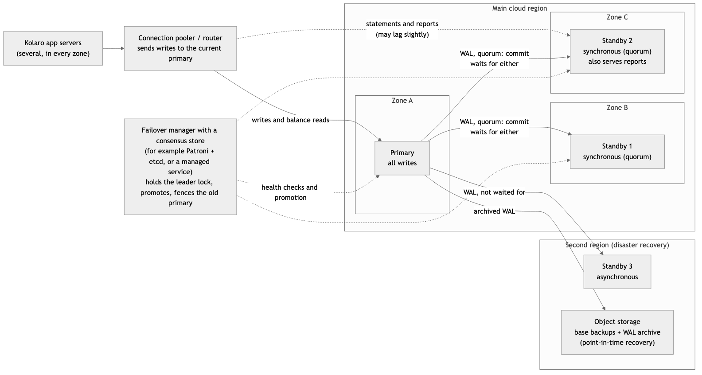

# Portfolio 5: Distributed and Cloud Databases

How Kolaro Wallet's PostgreSQL database behaves when it runs on more than one server. There are two separate local clusters:

1. **Replication:** three PostgreSQL 16 nodes with streaming replication. It shows synchronous and asynchronous standbys, replication lag, failover while the application is sending transfers, split brain, and rejoining the failed primary.
2. **Sharding:** a Citus 12.1 cluster (PostgreSQL 16) holding Portfolio 2's 4.2 million ledger entries across workers. It shows router and fan-out queries, joins, two-phase commit, a worker failure, and adding a worker while transfers continue.

Every figure below comes from the final run of each part ([replication/run.sh](replication/run.sh) and [sharding/run.sh](sharding/run.sh), both called by [run.sh](run.sh)), saved in [evidence/](evidence/). The README ends with a CAP/PACELC analysis and a proposed cloud deployment.

## Headline results

| Question | Result | Evidence |
|---|---|---|
| Does a synchronous standby lose confirmed transfers in a failover? | **No.** The primary was killed with SIGKILL during traffic. All **264** transfers it had confirmed were on the promoted standby. | [r5](evidence/r5_failover.txt) |
| Does an asynchronous standby? | **Yes.** A disconnected async standby was missing **all 264**. | [r5](evidence/r5_failover.txt) |
| How long was the outage? | **10.6 s** from the kill to the application's first confirmed transfer on the new primary. About 9.7 s of that was failure detection. | [r5](evidence/r5_failover.txt) |
| What does waiting for a standby cost? | With 10 ms of network delay to the standby, a transfer took **4.1 ms** when commits didn't wait for the standby and **20.0 ms** when they did. | [r3](evidence/r3_commit_cost.txt) |
| What if the only synchronous standby is down? | **Commits wait indefinitely.** Quorum commit (`ANY 1 of 2`) kept accepting transfers. | [r4](evidence/r4_sync_availability.txt) |
| Is split brain real? | **Yes.** The old primary restarted as a primary, the application's connection string chose it, and it committed a transfer the new primary never saw. `pg_rewind` discarded it. | [r6](evidence/r6_rejoin.txt) |
| How often do transfers span shards? | **97%** of October's 130,751 transfers had their two wallets on different shards. **50%** were on different workers. | [s4](evidence/s4_distributed_transactions.txt) |
| Can the cluster grow without downtime? | **Yes.** Adding a third worker moved 30 shard groups in **143 s**. Meanwhile **18,373** transfers committed with **0 failures**, and every balance still matched its ledger. | [s6](evidence/s6_rebalance.txt) |

## How to run it

From the repository root, with the main lab running (the sharding part loads its data from it):

```bash
./portfolio-5-distributed-cloud/run.sh
```

It takes about 12 minutes and needs internet access once, to install `tc` inside one container. It runs [replication/run.sh](replication/run.sh) and then [sharding/run.sh](sharding/run.sh). Each part has its own Docker Compose project, rebuilt from nothing and stopped at the end. The main lab must hold the Portfolio 2 data set; if it doesn't, run `./portfolio-2-query-optimisation/run.sh` first.

Each evidence file shows every statement, labelled with the node it ran on, followed by its result.

## Part 1: Replication

### The cluster

[replication/compose.yml](replication/compose.yml) starts three PostgreSQL 16 containers and a `client` container that plays the application.
- **node1** is created with `initdb`.
- **node2 and node3** clone it with `pg_basebackup` and stream its write-ahead log (WAL) ([node-entrypoint.sh](replication/node-entrypoint.sh)). Each has a replication slot on node1, so node1 keeps any WAL a standby hasn't received yet.
- The nodes are named by number, not role, because roles change during the failover demo.

The Kolaro schema is loaded on node1 only:
- Portfolio 1's tables and rules.
- Portfolio 3's rules and `transfer()` procedure.
- Portfolio 3's 20 stress-test wallets.
- Two demo wallets ([demo_wallets.sql](replication/demo_wallets.sql)).

Everything reaches the standbys through replication.

### R1 Setup ([evidence](evidence/r1_setup.txt))

- With `synchronous_standby_names = 'FIRST 1 (node2)'`, node1 reports node2 as `sync` and node3 as `async`.
- All three nodes hold the same 27 wallets, 36 ledger entries and N200,000 in the stress wallets.
- Both standbys refused writes: `cannot execute UPDATE in a read-only transaction`. A transfer committed on node1 was readable on both.

### R2 Replication lag and stale reads ([evidence](evidence/r2_lag_and_stale_reads.txt))

| Test | Result |
|---|---|
| **Lag under load:** 8 clients at about 530 transfers per second, sampled each second | Both standbys stayed within **0.1 to 9 ms** and a few kilobytes of node1. On one machine, lag is close to zero. |
| **Stale read from an async standby:** node3's replay paused, then a N5,000 transfer committed | node1 and node2 showed the new balances. **node3 still showed the old ones.** It had received the WAL but not applied it, and its data was 2.9 s old. After `pg_wal_replay_resume()` it matched. |
| **Stale read from the *synchronous* standby:** node2's replay paused | With the default `synchronous_commit = on`, the commit returned at once and **node2 served the old balance**. `on` waits until node2 has *flushed* the WAL, not *applied* it. |
| **`synchronous_commit = remote_apply`:** node2 still paused | The commit **waited** (`wait_event = SyncRep`) until node2's replay was resumed. Then node2 showed it. |

So "synchronous" means durable on the standby, not visible there. Reading your own write from a standby needs `remote_apply`, or reads sent to the primary.

### R3 The cost of synchronous commit ([evidence](evidence/r3_commit_cost.txt))

Each row is one client running Portfolio 3's `transfer()` for 8 seconds, so no request waits for another's locks. Then `tc netem` added 10 ms to node2's outgoing traffic, which raised the round trip from 0.4 ms to 12.5 ms. That's roughly the distance between two cloud regions, or a slow link between zones.

| `synchronous_commit` | What COMMIT waits for | Same host | +10 ms to node2 |
|---|---|---:|---:|
| `off` | Nothing; the WAL is flushed shortly after | 0.9 ms | 1.0 ms |
| `local` | node1's disk | 3.1 ms | 4.1 ms |
| `remote_write` | node2 has received the WAL | 3.0 ms | 17.0 ms |
| `on` (default) | node2 has flushed it to disk | 5.1 ms | 20.0 ms |
| `remote_apply` | node2 has applied it | 4.4 ms | 20.0 ms |

- **Same host:** the differences are mostly disk-flush noise on a shared virtual disk.
- **With 10 ms of delay:** waiting for the standby made every transfer about **5 times slower** (4 → 17–20 ms), because each commit now includes a network round trip.
- **Unsafe levels:** `off` is fastest because it doesn't wait even for node1's own disk. A crash can then lose the last moments of commits, which is unacceptable for a ledger.

### R4 Availability when the synchronous standby fails ([evidence](evidence/r4_sync_availability.txt))

**node2 stopped, with `FIRST 1 (node2)`:**
- A transfer on node1 **waited indefinitely** (`SyncRep`), and other sessions couldn't see it.
- Cancelling the wait produced: `canceling wait for synchronous replication ... The transaction has already committed locally, but might not have been replicated`. **The client received success,** and the transfer became visible.
- So a timeout doesn't undo a commit; it only stops waiting for the standby.

**`ANY 1 (node2, node3)` (quorum commit):**
- With node2 still down, the next transfer committed immediately, confirmed by node3.
- When node2 restarted, its replication slot let it catch up, including both transfers made while it was away.

### R5 Failover under load ([evidence](evidence/r5_failover.txt))

The `client` container ran [app.sh](replication/app.sh), sending one transfer at a time.
- **Connection string:** `host=node1,node2,node3 target_session_attrs=read-write`. libpq tries each node in turn and uses the first that accepts writes, so the application can find a new primary without being reconfigured.
- **Retries:** a failed request is retried with the same idempotency key.
- **node3:** disconnected from the network first, so it fell behind like a distant async replica.

Then:
1. `docker compose kill node1` (SIGKILL).
2. A failure check probed node1 once a second, with a 1-second timeout. libpq raises any connect timeout under 2 s to 2 s, so each probe took about 3 s, and node1 was declared failed after 3 misses.
3. `SELECT pg_promote()` on node2. node2's log: `selected new timeline ID: 2`, `archive recovery complete`.

| Event | Seconds after the kill |
|---|---:|
| Last confirmation from node1 | +0.09 |
| node1 declared failed | +9.70 |
| node2 promoted | +10.26 |
| **First confirmation from node2 (RTO)** | **+10.64** |

- **What the application saw:** 264 transfers confirmed by node1, then 4 by node2, and 3 failed attempts (one dropped connection, two timeouts), each retried.
- **Recovery point (RPO):** all **264** transfers node1 had confirmed were on node2 (**0 missing**). node3 was 36 s behind and missing **all 264**. That's what promoting the wrong standby would have lost.

**Findings:**
- **Detection was 91% of the outage.** Probing faster cuts it, but risks promoting during a short network blip. That trade-off is why failover managers use timeouts of several seconds.
- **The application recovered slowly at first.** Each new connection tried node1 first and waited out its timeout. Persistent connections, a connection router, or updating the address list after failover avoid this.
- **Transfer IDs jump at failover.** node2 issued 34057 right after node1's 34049. A standby's sequences are ahead by up to 32 cached values, so IDs have gaps after a failover but are never reused on the new primary.

### R6 Rejoining, and split brain ([evidence](evidence/r6_rejoin.txt))

- **node3 follows the new primary.** A slot was created on node2, and node3's `primary_conninfo` was changed to node2 and reloaded. node3 then streamed timeline 2 from node2 and caught up, including the 264 transfers.
- **Split brain.** `docker compose start node1` brought the old primary back as a primary on timeline 1, alongside node2 on timeline 2.
  - The application's connection string chose node1 (`application_would_write_to = node1`).
  - A N7,000 transfer sent there waited for node2, which no longer followed it. Once cancelled, it stayed committed on node1 only.
  - node1 and node2 then disagreed about wallet 3100000002 (N54,500 against N61,500).
  - The split-brain transfer received **transfer_id 34057, the same ID node2 had already used** for a different transfer.
- **Fencing and pg_rewind.** node1 was stopped, then `pg_rewind` copied back from node2 the blocks changed since the two histories split. It reported `servers diverged at WAL location 0/8E730D8 on timeline 1`. node1 restarted as a standby of node2, and its split-brain transfer was gone.
- **Final state.** node2 is the primary with `ANY 1 (node1, node3)`; both standbys are streaming with `quorum`. All three nodes have the same 34,053 transfers and the same checksum of them. The stress wallets still total N200,000 and the demo wallets N100,000. Portfolio 3's balance check and request check found 0 mismatches.

Here, synchronous replication *limited* the damage: node1's split-brain commit couldn't be acknowledged normally, because its synchronous standby had moved on. A primary with only async standbys would have confirmed it straight away. Real systems prevent this with fencing: only the node holding a lock in a consensus store may act as primary.

## Part 2: Sharding with Citus

### The cluster and the shard key

[sharding/compose.yml](sharding/compose.yml) starts a Citus coordinator and three workers. Two workers are registered at first.
- **Data:** [load.sh](sharding/load.sh) copies the Portfolio 2 data set from the main lab: 100,003 customers, 102,005 wallets, 2,078,000 ledger transactions, 4,156,000 ledger entries and 1,538,568 transfers. It loads in about 60 s.
- **Matching totals:** row counts, the ledger total (0) and the balance total (0) match the single server exactly ([s1](evidence/s1_cluster.txt)).

**The shard key is `wallet_id`.** Customer statements, balance checks and transfers are all about wallets.

| Table | How it is spread ([01_schema.sql](sharding/sql/01_schema.sql)) | Why |
|---|---|---|
| `wallets` | Distributed by `wallet_id`, 32 shards | — |
| `ledger_entries` | Distributed by `wallet_id`, **co-located** with wallets | A wallet and all its entries share a shard, so statements and balance audits stay on one worker |
| `transfers` | Distributed by `source_wallet_id`, co-located with wallets | A customer's outgoing transfers sit with their wallet |
| `ledger_transactions` | Distributed by `transaction_id` | No wallet column to co-locate on |
| `customers` | Distributed by `customer_id` | — |
| `merchants` | **Reference table**: a full copy on every node | Small, and joined by reports |

**What sharding gave up.** Citus can only enforce uniqueness that includes the shard key, because each shard checks only its own rows.
- `UNIQUE (phone)` on customers and `UNIQUE (wallet_number)` on wallets were refused: `Distributed relations cannot have UNIQUE ... constraints that do not include the partition column`.
- Foreign keys survive only between co-located tables, or into reference tables. The keys from transfers to the destination wallet, and from entries to ledger_transactions, were dropped.
- In production, those rules would move to lookup tables sharded by phone or wallet number, or into the application.

**Uneven data.** worker1 holds 1.82 million entries and worker2 2.34 million. Hashing spreads *wallets* evenly, but a few very active merchant and system wallets carry many entries, and one wallet can't be split across shards.

### S2 Router and fan-out queries ([evidence](evidence/s2_router_and_fanout.txt))

- **A customer statement** (`WHERE wallet_id = 50000`) is a **router query**: `Task Count: 1`, sent to worker2, where it used Portfolio 2's index (`Index Only Scan`, under 1 ms on the worker).
  - End to end it took 169 ms. Almost all of that is the coordinator's overhead under emulation, not the query.
- **Monthly volumes over all 4.2 million entries** is a **fan-out query**: `Task Count: 32`. Each shard grouped its own rows; the coordinator received 16 kB of partial results and combined them.
  - It took **1.49 s**, against **2.65 s** on the single server, even with Citus running under emulation.

### S3 Joins ([evidence](evidence/s3_joins.txt))

| Join | How Citus ran it | Time |
|---|---|---:|
| Balance audit: wallets with the sum of their entries (co-located on `wallet_id`) | Pushed down whole: each worker joined its own shard pairs | 1.46 s, 0 mismatches in 102,004 wallets |
| October merchant takings by category (reference table) | Pushed down: every worker has `merchants` | 1.02 s |
| Entries joined with their `ledger_transactions` (different shard keys) | **Refused** at first: `the query contains a join that requires repartitioning` | — |
| The same, with `citus.enable_repartition_joins = on` | Both sides re-sharded on `transaction_id` and shipped between workers | **24.4 s**, against 0.89 s on one server |

Joins that follow the shard key are cheap. Joins against it move data across the network and get far slower. The shard key decides which queries scale.

### S4 Transfers across shards: two-phase commit ([evidence](evidence/s4_distributed_transactions.txt))

[sql/02_transfer.sql](sharding/sql/02_transfer.sql) follows Portfolio 3's `transfer()`: lock both wallets in `wallet_id` order, check, then post. `citus.log_remote_commands` shows what the coordinator sends to each worker.

- **Wallets on different workers:** the coordinator opened a transaction on each worker and sent each statement to the shard that owns it. It then ran **`PREPARE TRANSACTION`** on both workers and, only after both succeeded, **`COMMIT PREPARED`** on both. This is two-phase commit: no worker commits unless every worker has promised it can. Citus records the decision in `pg_dist_transaction`, so it can recover if the coordinator fails mid-way.
- **Both wallets in the same shard:** two workers still took part, and the commit still used 2PC. The new `ledger_transactions` row is placed by its own `transaction_id` and landed on the other worker. **A design finding:** with the transaction header sharded separately, nearly every transfer needs 2PC. Adding the source `wallet_id` to `ledger_transactions` and co-locating it with wallets would keep same-shard transfers on one worker.
- **Atomicity across workers:**
  - A transaction credited a worker2 wallet, then debited a worker1 wallet by more than it held.
  - The debit broke `wallet_balance_not_negative` on worker1, and the credit on worker2 was rolled back too. Both balances were unchanged.
- **Real traffic:**
  - Of October's 130,751 transfers, only **3.1%** had both wallets in one shard. 47.1% were on one worker but in different shards, and **49.9%** were on different workers.
  - Customers send money to anyone, so no wallet-based shard key can keep transfers local.
- **Throughput** (4 clients, 15 s, no shared wallets): same-shard pairs ran at **292 transfers/s (13.7 ms)**, cross-worker pairs at **200 transfers/s (20.0 ms)**. That's slower, but not dramatically, because both kinds mostly used 2PC for the reason above. No prepared transactions were left over.

### S5 A worker fails ([evidence](evidence/s5_worker_failure.txt))

With worker2 stopped:
- **Worked:** a statement for a wallet on worker1.
- **Failed:** a statement for a wallet on worker2, and any query over all entries (`connection to the remote node kolaro@worker2:5432 failed`).
- **Mixed:** five transfers between two worker1 wallets: **2 succeeded and 3 failed.** The failures were the ones whose new `ledger_transactions` row belonged on worker2.

Citus didn't return partial or stale results; it refused. In CAP terms, it chose consistency over availability. Each worker is a single point of failure for its shards, so a production cluster gives every worker its own streaming standby, as in Part 1. When worker2 restarted, everything worked again.

### S6 Adding a worker while transfers continue ([evidence](evidence/s6_rebalance.txt))

**Rebalance:**
- `citus_add_node('worker3')`, then `citus_rebalance_start(shard_transfer_mode => 'force_logical')`.
- Citus scheduled **30 moves**. Each move copies a shard group to worker3, keeps it in sync with logical replication, then switches over with a brief lock.

**Traffic during the move:** 4 pgbench clients kept sending cross-worker transfers the whole time.

| | worker1 | worker2 | worker3 |
|---|---|---|---|
| Before | 80 shards, 581 MB | 80 shards, 668 MB | — |
| After | 55 shards, 402 MB | 55 shards, 391 MB | 50 shards, 470 MB |

**Results:**
- **Duration:** the rebalance took **143 s**.
- **Traffic:** **18,373 transfers committed, 0 failed**.
- **Totals after the move:**
  - Ledger entries grew by exactly 2 per transfer (36,746).
  - The ledger and the balances still net to 0.
  - The balance audit found **0 mismatches** in 102,004 wallets.

## Part 3: Consistency, availability and latency

**CAP:** during a network partition, a distributed database must either refuse some requests (stay **C**onsistent) or answer them anyway (stay **A**vailable, possibly wrong or stale).

**PACELC** (Abadi, 2012) adds: **E**lse, in normal running, it trades **L**atency against **C**onsistency.

The evidence above puts numbers on both:

| Choice | During a failure | In normal running | Seen in |
|---|---|---|---|
| Sync standby, `FIRST 1` | **C**: commits block until the standby returns | **C**: every commit pays a round trip (4 → 20 ms at +10 ms) | R3, R4.1 |
| Quorum, `ANY 1 of 2` | C, and survives one standby failure | C, paying the faster standby's round trip | R4.2 |
| Async standby | **A**: keeps accepting; a failover to it **lost 264 confirmed transfers** | **L**: no wait | R5.4 |
| Reads from standbys | **A**: answer even if stale (2.9 s old in R2.2) | **L**: offload the primary; `remote_apply` adds C back at a cost | R2 |
| Citus shards | **C**: queries needing a failed worker are refused | 2PC on cross-worker writes: 13.7 → 20.0 ms | S4, S5 |
| Split brain (no fencing) | Neither: two primaries accept conflicting writes | — | R6.2 |

**The choice for Kolaro:**
- **Money movement chooses consistency.** It's better to refuse a transfer for a few seconds than to lose one that was confirmed, or to let two primaries post different ones.
  - So transfers use a synchronous **quorum** of standbys, in zones close enough that the round trip costs a few milliseconds, not twenty.
  - Balance checks before a debit always read the primary, under Portfolio 3's row locks.
- **Statements, reports and the MongoDB read models (Portfolio 4) choose availability and latency.** They can read from standbys or projections a moment behind.

## Part 4: Proposed cloud deployment



### Today: one primary with standbys

- **Primary and two synchronous standbys** in three availability zones of one cloud region, with `synchronous_standby_names = 'ANY 1 (...)'`.
  - Any single zone can fail without losing a confirmed transfer (R5) and without blocking commits (R4.2).
  - Zones in one region are typically 1–2 ms apart, so the synchronous cost is far below R3's +10 ms case.
- **Asynchronous standby in a second region** for disaster recovery. It accepts some data loss (RPO above 0, as R5.4 showed) in return for no latency cost.
- **Continuous backups:** base backups plus archived WAL in object storage. That allows point-in-time recovery, which replication can't give: a mistaken `DELETE` replicates to every standby instantly.
- **A failover manager with fencing:**
  - Options: Patroni with etcd, or a managed service such as Amazon RDS Multi-AZ, Azure Database for PostgreSQL with zone-redundant HA, or Google Cloud SQL HA.
  - It must do what R5 and R6 did by hand: detect the failure, promote the most up-to-date synchronous standby, and stop the old primary from accepting writes (R6.2).
  - The application connects through a router or pooler that always points at the current primary.
- **Targets:**
  - **RPO 0** for confirmed transfers.
  - **RTO under a minute.** Most of that is detection, as R5 measured.
- **Data protection:** the Nigeria Data Protection Act 2023 regulates transferring personal data out of Nigeria. Choosing a cloud region, including the disaster-recovery region, is a compliance decision as well as a technical one.

### Later: when one primary isn't enough

- **When:** when write volume or data size outgrows one primary, move to Citus (Azure offers it as a managed service, Azure Cosmos DB for PostgreSQL).
- **Shard key:** `wallet_id`, with `ledger_transactions` co-located (S4's design finding).
- **High availability:** each worker gets its own standbys. S5 showed a worker is otherwise a single point of failure.
- **Growth:** add workers online, as S6 did.

## Limitations

- **One machine.** All "nodes" share one host's CPU and disk, so lag figures are optimistic. The 10 ms delay in R3 is simulated with `tc netem`, and real networks also drop and reorder packets.
- **Citus runs under emulation.** Citus publishes x86-64 images only, so on this Apple-silicon Mac it ran under emulation. Its absolute timings are slower than native; compare Citus timings with each other, not with the single server, except where the gap is large (S3's 24 s repartition join).
- **Failover was scripted, not automatic.** The detection loop and `pg_promote()` stand in for a failover manager, and there is no real fencing. The point was to measure each step and show what goes wrong without fencing.
- **No backup or point-in-time recovery demo.** It's covered in the deployment design only.
- **Cut-down rules on Citus.** The Citus schema keeps Portfolio 1's CHECK constraints but not Portfolio 3's triggers (Citus doesn't run triggers on distributed tables by default). `transfer_by_id` takes wallet IDs, because finding a wallet by number would query every shard.
- **Lab-only authentication.** Citus nodes trust connections from inside their Docker network. Production would use passwords or certificates, and TLS.

## Environment

- PostgreSQL 16 (`postgres:16-alpine`) and Citus 12.1.6 on PostgreSQL 16.6 (`citusdata/citus:12.1`).
- Docker on OrbStack, with 8 CPUs and 4 GB.
- The diagram was drawn with mermaid-cli 11.4.2 from [deployment.mmd](deployment.mmd).

## References

- PostgreSQL 16 documentation:
  - [High availability, load balancing and replication](https://www.postgresql.org/docs/16/high-availability.html)
  - [Replication settings and `synchronous_commit`](https://www.postgresql.org/docs/16/runtime-config-replication.html)
  - [WAL configuration](https://www.postgresql.org/docs/16/runtime-config-wal.html)
  - [pg_basebackup](https://www.postgresql.org/docs/16/app-pgbasebackup.html)
  - [pg_rewind](https://www.postgresql.org/docs/16/app-pgrewind.html)
  - [libpq multiple hosts and `target_session_attrs`](https://www.postgresql.org/docs/16/libpq-connect.html#LIBPQ-MULTIPLE-HOSTS)
  - [Two-phase transactions](https://www.postgresql.org/docs/16/two-phase.html)
- [Citus documentation](https://docs.citusdata.com/en/v12.1/): distributed tables, co-location, reference tables, rebalancing.
- Abadi, D. (2012) 'Consistency tradeoffs in modern distributed database system design: CAP is only part of the story', *Computer*, 45(2), pp. 37–42.
- Brewer, E. (2012) 'CAP twelve years later: how the "rules" have changed', *Computer*, 45(2), pp. 23–29.
- Gilbert, S. and Lynch, N. (2002) 'Brewer's conjecture and the feasibility of consistent, available, partition-tolerant web services', *ACM SIGACT News*, 33(2), pp. 51–59.
- Cubukcu, U., Erdogan, O., Pathak, S., Sannakkayala, S. and Slot, M. (2021) 'Citus: distributed PostgreSQL for data-intensive applications', *Proceedings of the 2021 International Conference on Management of Data (SIGMOD '21)*, pp. 2490–2502.
- Nigeria Data Protection Act 2023.
